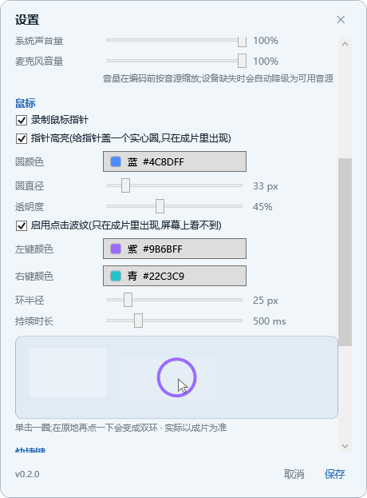

# ScreenRec

> **免安装直用**：无需编译，到 [Releases](../../releases/latest) 下载 `ScreenRec-thin.zip`（约 0.8 MB），解压后双击 `ScreenRec.exe` 即可录制。需先装 [.NET 9 Desktop Runtime (x64)](https://dotnet.microsoft.com/download/dotnet/9.0)；仓库 `dist/` 目录内也附带同一份 zip。

开源免费的 Windows 录屏工具。全屏 / 选区 / 窗口录制，双轨音频，鼠标特效只出现在成片里，免安装、零广告、零会员。


| 指针高亮（实心圆，透明度可调） | 点击：单环 | 同位置双击：变双环 |
|---|---|---|
|  |  |  |



> 当前版本 **1.0.0-rc1**。许可证 MIT。

## 为什么自己写

- 鼠标点击效果这种基础功能，在不少商业录屏软件里被做成会员专属
- 现有免费方案要么塞广告，要么效果走覆盖层路线——录制时自己屏幕上也看得见
- 目标：效果只出现在成片里、默认参数顺手、单程序免安装、不联网

## 功能

**录制**
- 全屏、选区、指定窗口三种录制源
- 帧率 15/24/30/60；画质四档只决定码率，分辨率跟随录制源
- 暂停 / 恢复（分段录制 + 原生流复制合并，不重编码）
- 定时切段：默认 5 分钟，崩溃最多丢最后一段；重新打开时自动把残留分段拼回去
- 录制中截图
- 磁盘预检：开录前按码率估算用量，录制中剩余不足 300 MB 自动停录保文件
- 分辨率变化、拔显示器时自动收尾

**音频**
- 仅系统声 / 仅麦克风 / 双轨 / 静音四种模式
- 设备缺失自动降级并提示；系统声与麦克风音量分别可调
- 48 kHz 立体声，AAC 128 kbps

**鼠标特效（只在成片里出现，录制时屏幕上看不见）**
- 指针高亮：半透明实心圆，颜色、直径、透明度可调
- 点击环：单击画一圈；同一位置双击，外面再套一圈浅色环；停留到设定时长后消失
- 左键、右键各用一个颜色，28 色色盘选色

**操作**
- 全局快捷键：开始/停止、暂停/继续、录制中截图（F1~F12 可改，可禁用）
- 悬浮控制条：呼吸红点 + 时长 + 暂停/继续 + 停止，位置记忆
- 系统托盘：左键唤回，右键菜单含开始录制 / 打开目录 / 设置
- 完成后气泡通知，点击直达文件
- 14 套皮肤，切换即时预览

**输出**
- 直写 mp4（H.264 High profile + AAC），不依赖 ffmpeg
- 输出目录与文件名模板可配（`{yyyyMMdd_HHmmss}` 占位）

### 录制源

| 模式 | 录什么 | 出片尺寸 |
|---|---|---|
| 全屏 | 主显示器 | 主屏原生分辨率 |
| 选区 | 虚拟桌面上框出的区域，自动归到覆盖面积最大的那台显示器 | 选区大小（物理像素） |
| 窗口 | 指定窗口的内容，被别的窗口遮挡也照录 | 跟随窗口 |

一次只录一台显示器，不拼超宽画面。要录副屏全屏，用选区把那台屏框满即可。

## 下载与运行

发布页只提供 **thin 包**（约 0.8 MB），需要先装一次 [.NET 9 Desktop Runtime (x64)](https://dotnet.microsoft.com/download/dotnet/9.0)。解压后双击 `ScreenRec.exe`。

仓库里也放了一份同样的包：[dist/ScreenRec-thin.zip](dist/ScreenRec-thin.zip)（SHA256 见 [RELEASE.md](RELEASE.md)）。

想要“解压即用、不装运行时”的便携版，见 [docs/portable.md](docs/portable.md)（自行构建）。

**首次运行会被 SmartScreen 拦**：程序没有代码签名，提示“Windows 已保护你的电脑”时点「更多信息 → 仍要运行」。介意可以自己用源码构建，版本说明里的 SHA256 可用于校验下载。

默认键位：**F9** 开始/停止、**F10** 暂停/继续、**F11** 截图。

## 设置

改动在点「保存」时写入 `%APPDATA%\ScreenRec\settings.json`，取消则整份丢弃（主题是即时预览，取消会还原）。

| 分组 | 项 |
|---|---|
| 外观 | 主题（14 套皮肤） |
| 视频 | 帧率、画质（码率档）、编码器（自动硬件优先 / 纯 CPU）、定时切段 |
| 音频 | 录音模式、系统声音量、麦克风音量 |
| 鼠标 | 录制指针、指针高亮（颜色 / 直径 / 透明度）、点击环开关、左/右键颜色、环半径、停留时长、1:1 预览 |
| 快捷键 | 开始/停止、暂停/继续、截图 |
| 输出 | 输出目录、文件名模板 |

鼠标分组带 1:1 预览：鼠标移进画布能看到高亮圆跟着走，点一下是单环，原地再点一下变双环。直径和透明度按「像素 ÷ DPI 缩放」绘制，和成片里的实际大小一致。

## 技术栈

| 层 | 选型 |
|---|---|
| UI | C# / .NET 9 + WPF（自绘主题） |
| 捕获 + 编码 | ScreenRecorderLib 7.0.1（WGC / Desktop Duplication + Media Foundation，硬件编码优先） |
| 音频 | WASAPI loopback + 采集设备 |
| 容器 | 直写 mp4（H.264 + AAC） |
| 进程模型 | UI 进程 + 独立 agent 进程（不加载 WPF），localhost TCP JSON 行协议 |
| 分段合并 | 自研 C++ / Media Foundation 流复制，不参与捕获或编码 |

### 架构

```
ScreenRec.sln
├─ ScreenRec.App        WPF:主面板、悬浮条、设置页、吐司、--selftest
├─ ScreenRec.Agent      独立录制宿主:无界面、不引 WPF
└─ ScreenRec.Core       录制会话、设置存储、诊断日志、屏幕信息、鼠标特效、原生工具调用

src\ScreenRec.Merger   独立 C++ 项目:MP4 流复制合并与媒体探测
```

主链路：UI 发 `start` → agent 创建 `Recorder`（显示器/窗口/选区 + 音频 + 鼠标特效）→ 内核完成捕获/合成/编码/封装 → 回调 `completed` 把路径给 UI。UI 只负责控制与展示，不碰帧。

状态机：`Idle → Recording ⇄ Paused → Finalizing → Idle`。

几条改代码前必须知道的硬约束（完整版见 [docs/notes.md](docs/notes.md)）：

- `ScreenRecorderLib` 类型必须晚于 `Assembly.LoadFrom` 被 JIT 引用，否则进程原生崩溃
- 不要调 `Recorder.GetSystemAudioCaptureDevices()`，本机必崩；麦克风只能用系统默认设备
- 鼠标特效总共有 2 层叠加层，不要再加：5 层时定时切段收尾会踩编码器 `0xC00D4A3E`
- 停录/暂停/切段前先摘特效，否则 `Stop` 会挂住

## 开发

环境：.NET 9 SDK + Visual Studio 2022 C++ 桌面开发工具（仅构建原生合并器需要）。

```bash
# 构建
dotnet build ScreenRec.sln

# 端到端自测:真实链路（起 agent 子进程 + TCP）,4 条用例
# 1. 全屏 3s + 截图 + 暂停 2s + 恢复 3s,校验时长/音轨/分段
# 2. 320×240 选区录制,校验成片分辨率
# 3. 定时切段 8s 连录 11s,校验 ≥2 段且合并后接近 11s
# 4. 切段后强杀 agent,校验残留分段能被救出
# 退出码 0 即通过
ScreenRec.exe --selftest

# 运行
ScreenRec.exe
```

诊断日志：`%TEMP%\screenrec_diag_yyyyMMdd.log`（按天滚动，保留 7 天）。

## 发布

```bash
powershell -ExecutionPolicy Bypass -File publish.ps1            # thin + portable
powershell -ExecutionPolicy Bypass -File publish.ps1 -Only thin # 只出精简包
```

| 包 | 体积 | 依赖 |
|---|---|---|
| `ScreenRec-thin.zip` | **0.80 MB** | .NET 9 Desktop Runtime (x64)；已含原生合并器 |
| `ScreenRec-portable.zip` | 56 MB | 无；自行构建，见 [docs/portable.md](docs/portable.md) |

不用 `PublishSingleFile`：混合程序集在单文件宿主里加载不了。发布说明见 [RELEASE.md](RELEASE.md)。

## 已知限制

- UAC 提权窗口录不到（系统限制，所有走 WGC 的录屏都一样）
- DRM 保护内容黑屏
- HDR 显示器色彩映射发灰
- 系统音频引擎采样率需为 48000 Hz（Windows 默认）
- 一次只能录一台显示器；全屏固定主屏，副屏请用选区框满
- 混合 DPI（不同屏缩放不同）下，副屏选框可能有几像素偏差
- 连续快速点击时，后一下的点击环会顶掉前一下（只维护一个点击层）
- 硬件编码器在极端场景（高动态 + 高码率 + 机器繁忙）可能报错中断，建议降到「中」画质或 30 fps

## 未来开发计划

按“对当前使用的帮助”排序，不按实现难度。没有时间表，做完一项发布一项。

**下一步**
- 编码器故障兜底：出错时自动降级到 CPU 编码重录一次，或至少保存已录部分并明确提示
- 麦克风设备选择：自己用 `IMMDeviceEnumerator` 枚举 WASAPI 设备，绕开会崩的库 API
- 安装包（Inno Setup）与版本更新提示

**看反馈再定**
- 摄像头画中画
- 画笔批注（录制中圈重点）
- 英文界面 / 英文文档
- 输出 GIF、导出音轨

**需要换底层才做**
- 扩散波纹（点击时水波扩散、边扩边淡）
- 4K60 录制
- HDR 色彩映射

这三项都要在编码前自己合成帧，也就是接管现在由 ScreenRecorderLib 完成的“捕获 → 合成 → 编码”，换成 WGC + D3D11 + Media Foundation 的自研管线。代价是现有的稳定性、分段、崩溃恢复都要重做一遍，所以放在最后。

**明确不做**

视频剪辑、云上传/分享、直播推流、视频列表管理（只提供“打开输出目录”）、点击音效、水印、会员、广告。

## 许可

本项目以 MIT 许可发布，见 [LICENSE](LICENSE)。第三方组件见 [THIRD-PARTY-NOTICES.md](THIRD-PARTY-NOTICES.md)。
